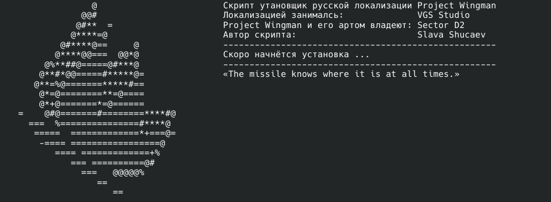

# Project Wingman на русском языке

Скрипт установщик русской локализации от VGS Studio : озвучка, субтитры и интерфейс. Скрипт ставить в пару нажатий.

**Поддерживаемые устройства :**  любые Linux-дистрибутивы

**Оригинальный лаунчер :** [PWRuLauncher](https://github.com/RikudoSmpai/PWRuLauncher/tree/main)  



## Как поставить

Нужны библиотеки libcurl и libarchive: на SteamOS (Steam Deck), Arch, Fedora и Ubuntu они обычно уже есть.
На Steam Deck — в режиме рабочего стола, в Konsole:

```bash
# Скачать скрипт
curl -L -o pwru_script https://github.com/SlavaShucaev/PWRuScript/releases/latest/download/pwru_script
# Выдать скрипту права на исполнение
chmod +x pwru_script
# Запустить скрипт
./pwru_script
```

Скрипт сам найдёт игру, скачает и проверит файлы перевода и подскажет про параметр запуска
(см. ниже «Linux и Steam Deck: параметр запуска Proton»).

## Как удалить мод

Скрипт сам удалить все компоненты локализации.
Откройте Konsole `Ctrl + Alt + T` и вставте следующию команду :
```bash
./pwru_script --uninstall
```
Когда скрипт удалит локализацию, закройте Konsole.

## Цель проекта

Создать удобный способ установки русской локализации Project Wingman от VGS Studio на устроствах под управлением Linux-дистрибутивов

## Как собрать у себя

Чтобы собрать проект на своём ПК необходимо установить:
- CMake
- Libcurl
- Libarchive

**Шаг 1** Скопировать репозиторий
```bash
git clone "https://github.com/SlavaShucaev/PWRuScript.git"
```

**Шаг 2** Сгенерировать конфигурацию CMake 
```bash
# Создаём папку build и перодим в него
mkdir build && cd build
# Генерация конфигурации для сборки
cmake -G "Unix Makefiles" ..
```

**Шаг 3** Сборка проекта
```bash
cmake --build .
```

Тесты логики (суммы, параметр запуска, старая правка exe; без сети и файлов игры):
```bash
cmake -DPWRU_BUILD_TESTS=ON .. && cmake --build . && ctest --output-on-failure
```

## Linux и Steam Deck: параметр запуска Proton

Под Linux игра работает через Proton, а он по умолчанию берёт свою `dwmapi.dll` вместо той, через которую
грузится UE4SS. Без UE4SS не будет русского языка при каждом запуске (он сбрасывается на английский),
перевода текста мимо субтитров и титров локализации. Нужен параметр запуска:

```
WINEDLLOVERRIDES="dwmapi=n,b" %command%
```

Скрипт сам проверяет, стоит ли он. Если Steam закрыт, скрипт предложит вписать параметр в настройки
Steam (`userdata/<id>/config/localconfig.vdf`, рядом сохранит копию `.bak-pwru`; то, что вы уже вписали
в параметры запуска, сохранится). Если Steam запущен, впишите параметр сами:

- **Steam:** Библиотека → Project Wingman → Свойства → Общие → Параметры запуска.
- **Steam Deck:** скрипт запускается в режиме рабочего стола (Konsole). Параметр — в игровом режиме:
  Project Wingman → ⚙ → Свойства → Параметры запуска (или в режиме рабочего стола, закрыв Steam перед
  запуском скрипта: Steam → Выход).

## Проверка файлов

Озвучка, субтитры и UE4SS скачиваются из последнего релиза
[PWRuLauncher](https://github.com/RikudoSmpai/PWRuLauncher/releases/latest) и сверяются с суммами из
`PW_RU_mods.sha256` того же релиза (есть начиная с 1.0.6). Файл не совпал — он удаляется, установка
останавливается.

## Что именно попадает в папку игры

| Файл | Зачем |
|---|---|
| `ProjectWingman\Content\Paks\~mods\PW_RU_Voice.pak` | русская озвучка |
| `ProjectWingman\Content\Paks\~mods\PW_RU_Subs.pak` | субтитры и тексты игры |
| `ProjectWingman\Binaries\Win64\dwmapi.dll`, `UE4SS.dll`, `UE4SS-settings.ini`, папка `Mods\` | UE4SS: русский язык при каждом запуске, перевод текста мимо субтитров, титры локализации |
| `ProjectWingman\Content\Movies\HumbleIntro_PW.mp4` | интро (оригинал рядом в `.pwru-orig`) |

## Проблемы

Пишите в [Issue](https://github.com/SlavaShucaev/PWRuScript/issues), если столкнётесь с проблемами при работе скрипта.

---
Материалы локализации принадлежать : [VGS Studio](https://t.me/VGSPLF "Ссылка на Телеграм канал VGS Studio")  
[Project Wingman](https://store.steampowered.com/app/895870/Project_Wingman/ "Страница игры в Steam") и связанные с ним материалы принадлежат : Sector D2 
